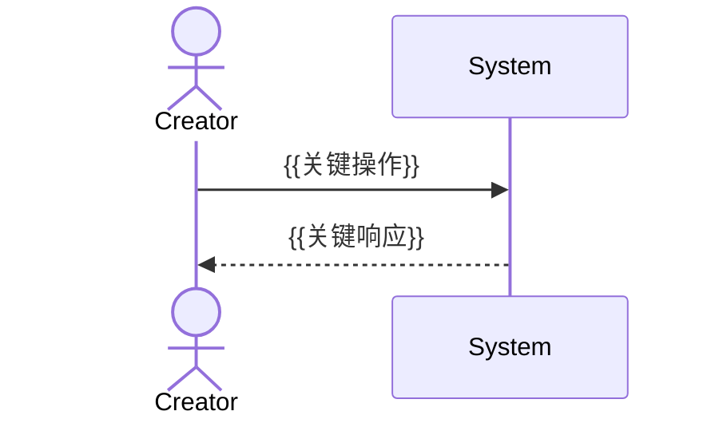

# 产品规格（PRODUCT_SPEC）

---

## 1. 产品定位

{{1-3 句话描述产品是什么、为谁服务、解决什么问题。}}

---

## 2. 用户角色

| 角色 | 代码 | 描述 | 典型操作 |
|------|------|------|---------|
| {{角色1}} | `{{CODE}}` | {{描述}} | {{典型操作}} |
| {{角色2}} | `{{CODE}}` | {{描述}} | {{典型操作}} |

---

## 3. 限界上下文目录（系统设计视图）

> 本节以 DDD 视角展示系统的 BC 划分。FD 与 BC 的映射关系在 §10 维护。
> 详细 BC 规格见 `SDD/01-specs/bc/bc-{NN}-{domain}/spec.md`。

### 3.1 核心域（Core Domain）

> 平台差异化竞争优势所在，投入最高研发资源

| BC 编号 | BC 名称 | 主要聚合根 | 微服务策略 | 状态 |
|--------|--------|---------|---------|------|
| BC-01 | {{名称}} | {{聚合根1, 聚合根2}} | {{独立微服务 / NestJS 模块}} | {{v1.0}} |
| BC-02 | {{名称}} | {{聚合根}} | {{策略}} | {{v1.0}} |

### 3.2 支撑子域（Supporting Subdomain）

| BC 编号 | BC 名称 | 主要聚合根 | 微服务策略 | 状态 |
|--------|--------|---------|---------|------|
| BC-03 | {{名称}} | {{聚合根}} | {{策略}} | {{v1.0}} |
| BC-04 | {{名称}} | {{聚合根}} | {{策略}} | {{v1.1}} |

### 3.3 通用子域（Generic Subdomain）

| BC 编号 | BC 名称 | 采购/复用方案 | 状态 |
|--------|--------|------------|------|
| BC-{{NN}} | {{名称}} | {{如：审计日志，采用企业统一审计平台}} | {{v1.0}} |

### 3.4 应用服务（Application Services）

> 应用服务不含业务规则，仅跨 BC 用例编排。

| AS 编号 | 应用服务名称 | 编排的 BC | 核心用例 |
|--------|------------|---------|---------|
| AS-01 | {{名称，如 Skill 发布流程}} | BC-01, BC-02, BC-03 | {{发布 Skill 的完整流程}} |
| AS-02 | {{名称}} | {{BC 列表}} | {{核心用例}} |

---

## 4. 产品能力架构图（四层 DDD 视图）

```
┌──────────────────────────────────────────────────────────────────┐
│                     Interface Layer  界面层                         │
│  ┌────────────────┐  ┌────────────────┐  ┌────────────────┐       │
│  │ {{Consumer      │  │ {{Creator       │  │ {{Admin         │       │
│  │   Portal}}      │  │   Studio}}      │  │   Console}}     │       │
│  └────────────────┘  └────────────────┘  └────────────────┘       │
├──────────────────────────────────────────────────────────────────┤
│                  Application Service Layer  应用服务层               │
│  ┌────────┐  ┌────────┐  ┌────────┐  ┌────────┐  ┌────────┐     │
│  │ AS-01  │  │ AS-02  │  │ AS-03  │  │ AS-04  │  │ AS-05  │     │
│  │{{名称}} │  │{{名称}} │  │{{名称}} │  │{{名称}} │  │{{名称}} │     │
│  └────────┘  └────────┘  └────────┘  └────────┘  └────────┘     │
├──────────────────────────────────────────────────────────────────┤
│                     Domain Layer  领域层                             │
│  ┌────────┐  ┌────────┐  ┌────────┐  ┌────────┐  ┌────────┐     │
│  │ BC-01  │  │ BC-02  │  │ BC-03  │  │ BC-04  │  │  ...   │     │
│  │[核心域] │  │[核心域] │  │[支撑]  │  │[支撑]  │  │        │     │
│  └────────┘  └────────┘  └────────┘  └────────┘  └────────┘     │
├──────────────────────────────────────────────────────────────────┤
│                  Infrastructure Layer  基础设施层                     │
│  {{DB}}  │  {{Cache}}  │  {{MessageBus}}  │  {{ExternalAPIs}}      │
└──────────────────────────────────────────────────────────────────┘
```

---

## 5. 核心业务流程（用户视角 Mermaid）

> 详细的跨 BC 多角色序列图见 `USER_JOURNEY_SPEC.md`。本节仅展示核心路径概览。

### 流程 1: {{流程名称，如 Skill 创建与发布}}



---

## 6. 功能域清单（产品规划视图）

> FD 是产品路线图的最小单元，每个 FD 的详细规格见 `SDD/01-specs/features/{NNN}-{domain}/spec.md`。

### FD 优先级分组

| FD 编号 | FD 名称 | 主要关联 BC | P | MVP | 发版 | 状态 |
|--------|--------|-----------|---|-----|------|------|
| FD-01 | {{名称}} | BC-01, BC-05 | P0 | ✓ | v1.0 | 开发中 |
| FD-02 | {{名称}} | BC-02, BC-03 | P0 | ✓ | v1.0 | 规划中 |

---

## 7. FD ↔ BC 映射关系

| FD 编号 | FD 名称 | 关联 BC（写） | 关联 BC（读）|
|--------|--------|------------|------------|
| FD-01 | {{名称}} | BC-01, BC-05 | BC-04（权限）|
| FD-02 | {{名称}} | BC-02, BC-03 | — |

---

## 8. 领域术语表

| 术语（中文）| 术语（英文）| 定义 | 所属 BC |
|-----------|-----------|------|--------|
| {{术语}} | {{Term}} | {{定义，1-2 句话}} | BC-{{NN}} |
| {{术语}} | {{Term}} | {{定义}} | BC-{{NN}} |

---

## 9. 非功能需求

| 类别 | 指标 | 要求 |
|------|------|------|
| 性能 | 接口响应时间（P90）| ≤ {{N}}ms（排除 AI 调用接口）|
| 性能 | 页面首屏时间（LCP）| ≤ {{N}}s |
| 可用性 | 服务 SLA | ≥ {{N}}% |
| 并发 | 峰值并发用户数 | {{N}} |

---

## 10. 里程碑与发版计划

| 里程碑 | 目标日期 | 包含 FD | 包含 BC（首次稳定）| 核心验收标准 |
|--------|---------|--------|----------------|------------|
| v1.0 | {{YYYY-MM}} | FD-01, FD-02 | BC-01, BC-02, BC-03 | {{用户路径描述}} |
| v1.1 | {{YYYY-MM}} | FD-03, FD-04 | BC-04, BC-06 | {{用户路径描述}} |

---

### 变更记录

| 版本 | 日期 | 变更内容 |
|------|------|----------|
| 1.0 | {{YYYY-MM-DD}} | 初始版本 |
