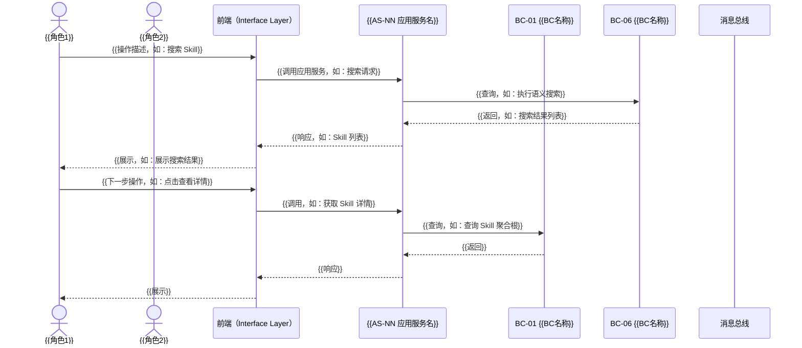
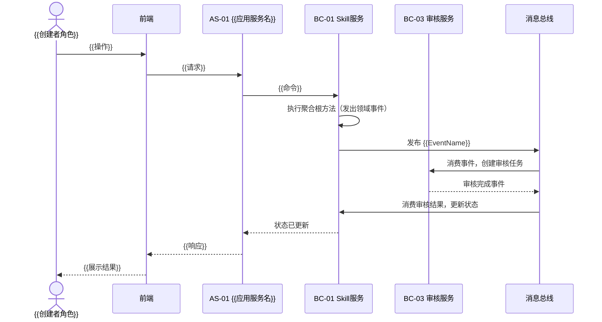

# 用户旅程规格（User Journey Spec）

> **职责**: 本文件定义跨 BC/FD 的完整用户旅程，以**多角色 Mermaid sequenceDiagram** 展示端到端路径。
>
> **职责边界（禁止越界）**:
> - ✅ 包含：完整的跨 BC/FD 序列图（参与者、消息、系统边界）
> - ✅ 包含：参与角色、关键 BC/FD、主路径和异常路径
> - ❌ 不包含：AC/BR（那是 Feature Spec 和 BC Spec 的职责）
> - ❌ 不包含：API 参数细节、数据库字段（那是 API_SPEC/DATA_SPEC 的职责）

---

## 用户旅程总览

| UJ 编号 | 旅程名称 | 主要角色 | 关键 BC/FD | 优先级 | 版本 |
|--------|---------|---------|-----------|--------|------|
| UJ-01 | {{旅程名称，如：发现并使用 Skill}} | {{角色列表}} | {{BC-01, BC-06}} | P0 | v1.0 |
| UJ-02 | {{旅程名称}} | {{角色}} | {{BC}} | P0 | v1.0 |

---

## UJ-01: {{旅程名称}}

**参与角色**: {{角色1}}、{{角色2}}
**关键 BC/FD**: {{BC-01 Skill服务、BC-06 搜索服务 / FD-01 Skill管理}}
**场景描述**: {{一句话描述这条旅程的业务目标}}

**主路径说明**: {{文字补充说明关键步骤或决策点}}

**异常路径**:
- {{异常情况1，如：Skill 已下架}} → {{系统响应}}
- {{异常情况2}} → {{响应}}

---

## UJ-02: {{旅程名称}}

**参与角色**: {{角色}}
**关键 BC/FD**: {{BC}}
**场景描述**: {{描述}}

---

## 角色×旅程覆盖矩阵

| 角色 | UJ-01 | UJ-02 | ... |
|------|-------|-------|-----|
| {{角色1}} | ✓ | ✓ | |
| {{角色2}} | | ✓ | |

---

## 变更记录

| 版本 | 日期 | 变更内容 |
|------|------|----------|
| 1.0 | {{YYYY-MM-DD}} | 初始版本 |
